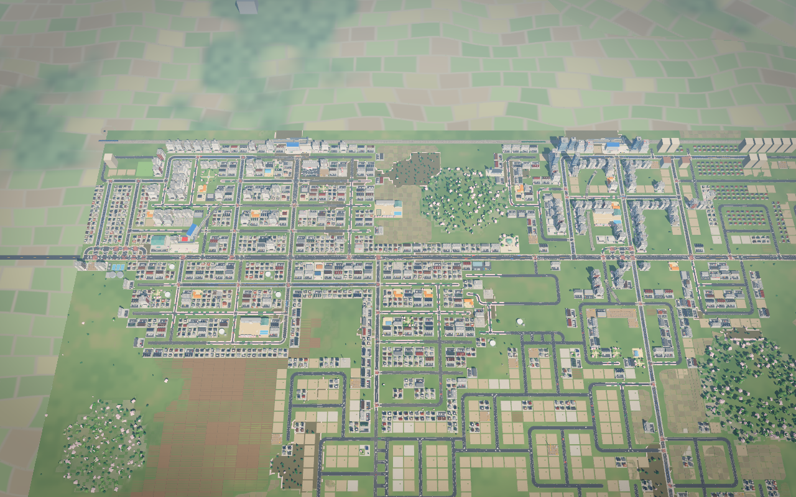

# v96 オートの宅地開発（道路の通っていない空き地に、格子状の生活道路を引いて使う）

作者の依頼：「オートの時、道路がないところに建物を建てなくなったせいで、道路を通していない空き地が空き地のままになっています。状況に応じて、空き地があるなら、道路や線路を工事することで、ちゃんと土地を有効活用するような人間ぽい、賢い動きにして。」

v95 で途中まで作った計画的な宅地開発（`src/autodev.ts` の `planGrid`、`src/autoplay.ts` の `gridDev`）を仕上げた。sim の計算は変えていない（オートは既存の操作 `dispatch` の `road`・`zone` だけを使う）。v94 の「道路に面していない所には建てない」はそのまま。

## 仕組み

### 開発の形（`planGrid`、v95 から）
- 既存の道路（市外までつながるもの）から垂直に 2 本の通りを延ばし（間隔 4〜6 区画）、3 区画ごとに横の通りでつなぐ「はしご型」。どの区画も道路に面し（横の通りの間は 2 区画）、2 本の通りは奥でつながるので行き止まりにならない。両方の通りが既存の道路に届けば輪になる。
- 道路は `planRoad`（急斜面・v94 の接続の規則＝grade の bad）で通せる区間だけを使い、既存の道路網につながる部分だけを引く。山・水面・湿地・保全林・急斜面・市街化調整区域は `devFree`（`buildable` など）で除く。
- 使えるようになる区画が 10 以上で、道路 1 区間あたり 0.8 区画以上のものだけ。

### v96 で足したこと
1. **選び方**（`planGrid` の点数）
   - 保育・学校（開業しているもの）から 12 区画以内を優先（近いほど高い）。
   - 浸水しやすい区画（`floodRisk`）が多い計画は下げる（水辺を避ける）。
   - 街の中心から遠いものをこれまでより強く下げる（1 区画 60 → 120）。
   - **街の中に取り残された空き地**（建物から 4 区画以内なのに道路が通っていない土地）を使う計画を上げる（1 区画 400）。`opt.infill` では、使えるようになる区画の 6 割以上が街の中のものだけを選ぶ。
   - 結果の `infill`（街の中の割合）を返す。`landSpare` は `innerBack`（街の中の取り残された空き地の数）も返す。
2. **街の中の空き地を埋める開発**（`autoplay.ts` 7d、新規）
   - 郊外の国道沿いに空き地が残っていても（v95 の 7c は「中心・駅の近くの道路沿いの空き地が少ない」ときだけ動くので、田園では動かなかった）、街の中に取り残された空き地が 40 区画以上あれば、ときどき格子状の生活道路を通して埋める。
   - 条件：上下水・電力に余裕がある（水道 5%・下水 3%・電力 5%）、その資金をためていない、空き家率 8% 未満、収支の見込み（v94 の headroom＝黒字−工事中の施設の人件費−市債の返済）が作戦ごとの値より大きい、選挙前でない。
   - 頻度は作戦で変える：どんどん攻めろ 毎月／バランス 2 か月／財布だいじに 4 か月（収支の見込みの下限も 100／250／600 万円）。
   - 急ぐ施設（保育・学校など）の資金をためている間でも、ためる額の 1 割ほどまでの小さな開発なら手元の資金で。上下水・電力のためにためている間はしない。
3. **上下水が工事中なら先に道路**（7c）：上下水の余力がなくても、浄水場・下水処理場が工事中で、足りない分が 5% 以内なら、先に道路を引いておく。
4. **財政**：道路の工事費は手元の資金で、維持費（1 区間 月 1.2 万円）は収支の見込みから引いて判断（v95 から）。**宅地開発の道路に市債は使わない**（下の「試してやめたこと」）。施設の用地がないとき（needLand）の開発だけは v95 のまま市債を使ってよい。
5. **計測用**：見送った理由を `gridLog`（`autodev.ts`）に数える。オートの判断には使わない。

### 沿道の用途・施設（v95 から、変更なし）
- 駅の近くは中高層、幹線の近くは中層、ほかは低層住宅。店が足りなければ地区の入口の数区画を商業に。
- 人が増えた地区の保育・学校・公園は、既存のオートの「近くに施設がない世帯の多いものから」の判断（9.）がそのまま拾う。

## 前後の比較（オート 10 年・ふつう・種 261011）

「前」は v95 の統合時点（cec3585、オートの宅地開発が途中の版）、「後」は v96。計測は `scripts/v95-land.ts`（`TERR=… YEARS=10 node …`）。

- 街の中の取り残し：建物から 4 区画以内で、建てられるのに道路に面していない空き区画の数
- 街の中の使用率：建物から 4 区画以内の建てられる区画のうち、道路か建物で使われている割合
- 市全体の取り残し：市の区域（解放済みの区画）全体の、道路に面していない建てられる空き区画（大半は田畑・山裾なので参考）

| 地形・作戦 | | 人口 | 街の中の取り残し | 街の中の使用率 | 市全体の使用率 | 市全体の取り残し | 宅地開発（回・道路区間） | 一時借入の月数 | 選挙（得票%） | 市債残高（万円） |
|---|---|---|---|---|---|---|---|---|---|---|
| coast・バランス | 前 | 12,531 | 1,626 | 41.4% | 6.1% | 24,886 | 3・49 | 4 | 64.1 / 56.7 | 220,125 |
| | 後 | 12,714 | **1,483** | **42.8%** | 6.1% | 24,834 | 5・72 | **2** | 64.1 / 61.6 | 216,983 |
| rural・バランス | 前 | 12,310 | 1,398 | 39.3% | 5.1% | 27,188 | 1・11 | 3 | 66.7 / 60.8 | 205,717 |
| | 後 | 12,298 | **1,340** | **40.0%** | 5.2% | 27,120 | 4・45 | 3 | 66.7 / 61.5 | 219,992 |
| urban・バランス | 前 | 21,249 | 1,561 | 42.4% | 5.6% | 25,127 | 2・42 | 0 | 62.0 / 61.1 | 306,996 |
| | 後 | **24,029** | **1,127** | **50.2%** | 7.0% | 24,454 | 21・372 | 0 | 61.0 / 58.4 | 323,504 |
| urban・財布だいじに | 前 | 18,270 | 1,423 | 40.9% | 4.9% | 25,333 | 1・44 | 0 | 62.8 / 52.9 | 174,242 |
| | 後 | 17,316 | **1,344** | **44.1%** | 5.4% | 25,123 | 5・111 | 0 | 55.4 / 58.3 | 176,971 |

- すべての地形で、街の中に取り残された空き地が減り（urban は 3 割減）、使用率が上がった。人口は urban で +13%、coast・rural はほぼ同じ、urban の財布だいじには −5%。選挙はすべて 2 回とも当選。
- coast は 10 年のうち約 4 年、上下水（主に下水処理場）が足りず、その資金をためている月が多いので、開発の機会が少ない（見送りの理由：上下水 45 回・収支 25 回など）。土地より上下水と市債の枠が成長を止めている。
- rural は国道沿いの空き地が多く、v95 の 7c（中心の近くの道路沿いの空き地が少ないとき）はほとんど動かない。v96 の 7d（街の中の空き地）が 8〜10 年目に動く。

### 全景

urban・バランス・10 年後（人口 24,029）。雲と煙は隠して撮った（撮影用の台本は作業用の一時ファイル。保存した街を `game.loadText` で読み込み、v92-map.mjs の全景と同じ手順で撮る）。

見たこと：中央の幹線の南（画面の下半分）に、既存の道路から延びたはしご型の生活道路がいくつも並び、格子状の街が南へ広がっている。行き止まりはほとんどなく、奥の横の通りでつながっている。沿道の多くは住宅に指定されて家が建ち始めているが、南端の新しい格子では指定だけで空いている区画（薄茶色）も多い（需要と上下水の余力に合わせて、少しずつ建つ）。北側の古い街区は v95 までの道路沿いの開発。

## テスト
- `npx tsc --noEmit`：通る。
- `tests/v96.test.ts`（新規 2 件：格子の計画が既存の道路につながり、取り残された区画を道路に面するようにする／工事費の上限）・`tests/v94.test.ts` のオート・`tests/sim.test.ts` の「作戦で積極性」：通る。
- `npx vitest run`：378 件通過、1 件失敗（「作戦で積極性」が 302 秒かかり時間切れ。全景の撮影と同時に回したため。単独では 137 秒で通る）。

## 試してやめたこと
- **宅地開発の道路に市債を使う**（住宅が足りないとき・街の中の空き地を埋めるとき）：urban で道路のために 4 回借りた結果、下水処理場の市債が組めず、6 年にわたり下水が足りないまま入れない世帯が 4 割に（人口 12,712、一時借入 13 か月）。rural でも道路の維持費と返済で施設が遅れ、人口が 2 割減った。道路は手元の資金だけで引くことにした。
- **上下水の余裕がないときに街の中の開発をする**：同じく施設の資金を食うので、上下水・電力に余裕があり、その資金をためていないときだけにした。

## 見送ったこと
- **鉄道の延伸・新駅**：ふつうのゲーム（任期）では線路は鉄道事業者の管理で市は変えられず（`validate.ts`：まちづくり版でだけ操作できる）、駅も `build: 'none'`（協議のみ）で、オートが使える操作がない。見送った。
- **バス**：駅とバス停から遠い住宅の多い道路にバス停をつくる既存の判断（10l、年 2 か所）が、開発した地区も拾う。路線の新設（10 の協議）も既存のまま。新しくは足していない。
- coast の下水処理場の遅れ（約 3 年、市債の affordable で止まる）は、v94 の財政の判断の問題で、今回の範囲外として直していない。

## 未検証
- 種は 1 つ（261011）、10 年、地形 3 つ。オートは小さな違いで後の展開が大きく変わる（同じ地形でも、最初の開発の場所が変わるだけで人口が 2 倍近く違う展開があった）ので、他の種・長い年数・どんどん攻めろは確かめていない。
- 実在の都市の地図（大きな地図）では回していない。
- 全景は 1 枚だけ（urban・10 年後）。格子の道路が引かれていく途中の様子は撮っていない。
