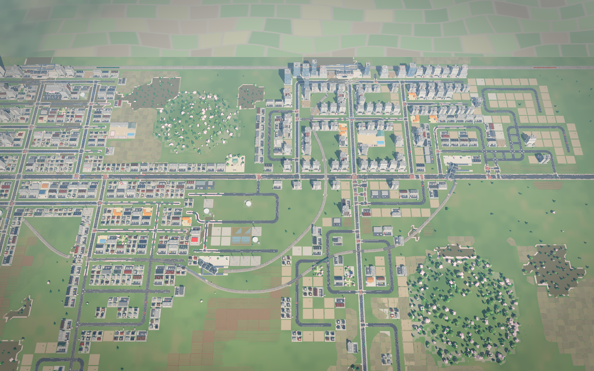

# v97 基盤と鉄道のオート 変更記録

オート（`src/autoplay.ts`）に、次の 2 つを入れた。sim の計算は変えていない（オートは既存の操作 `dispatch` だけを使う。`src/sim/raildev.ts` は道筋探しの関数を export し、`route` に省略できる重みの引数を足しただけで、鉄道会社の新線の計算は同じ）。

## 1. 暮らしに欠かせない基盤（上水・下水・電力）

### 原因
v96 の計測で、海辺の街（coast）は 10 年のうち 38 か月、下水処理場が足りなかった。調べると、止めていたのは財政の判断よりも先に **用地探し** だった。

- `findSpot` の下ごしらえ（`okLot`）が、敷地の角の斜め向かいや、敷地より長い範囲の道路も「道路に面している」と数えていた。下水処理場のような迷惑施設は住宅の少ない順に候補を並べるため、上位 60 か所がすべて `checkPlace` に「道路に面していません」で断られ、**20 か月（22〜42 か月目）用地が見つからなかった**。用地がないと買収（手元の資金が要る）に回り、それもできずに道路を延ばして待っていた。
- 用地が見つかったあとは、v94 の `affordable`（毎月の収支から返済を引いて黒字が残るか）で市債が組めず、さらに 12 か月待った（coast は収支がほぼ均衡したまま。実質公債費比率は 4% と低い）。
- 変電所（工事 18 か月）は余力 12% を切ってから動くので、urban では開業までの 1 年近く電力が足りなかった。

### 変更
1. **用地探しの辺の判定を直す**：`okLot` と `findBuyLot` は、敷地の辺に面した道路だけを見る（`checkPlace` と同じ）。ほかの施設の用地探しも、断られるだけの候補を読み飛ばさなくなった。
2. **工事期間の伸びを見込む**：上水・下水・電力は、直近 12 か月の人口の伸びから、工事の期間（浄水場 / 下水処理場 / 変電所の `months`）の間に増える需要を見込み、それより余力が 3% 少なければ建てる（従来の「余力 15% / 12% を切ったら」も残す）。
3. **財政が崩れない範囲で市債を組む**（`infraOk`）：上水・下水・電力は、`affordable` に通らなくても、次をすべて満たせば市債で建てる（現実の下水道事業債・水道事業債と同じく、基盤は借りて先に整える）。
   - 最近 6 か月に一時借入がない（`s.acts.tempAt` に一時借入のあった月を覚える）、健全化の段階がふつう
   - 借りたあとの実質公債費比率（直近 12 か月の返済と利子 ÷ 標準的な収入に、今回の返済を足す）が、攻め 18%・バランス 16%・財布 14% 以下（基準の 25% から十分遠い）
   - 12 か月平均の収支から、工事中の施設の人件費・返済・今回の返済を引いた赤字が、標準的な収入の 3% / 2% / 1.5% 以内
   - 財布だいじには、**実際に足りない月が 3 か月続いたときだけ**。そのときは作戦で絞った市債の上限（本当の上限の 6 割）ではなく、本当の上限の 95% まで
   - 市債の説明に「暮らしに欠かせない基盤なので、収支の見込みが苦しくても市債で先に整える」と出す

## 2. オートの鉄道の延伸と新駅（`src/autorail.ts`）

v96 の報告にあった「ふつうのゲームでは線路をオートが操作する手段がない」は誤りで、架空の街にも `s.rail`（北の端の東西の複線）があり、市は `{ type: 'rail' }` で線路を敷き、線路に面していれば駅を建てられる。オートにもこれを使わせた。

### 計画（`planBranch`）
- **どこへ**：駅勢圏の外（どの駅からも 30 区画＝約 900m より遠い）の住宅の戸数を数え、まとまり（半径 12 区画）の多い上位 3 か所を候補にする。戸数が作戦ごとの下限（攻め 150・バランス 200・財布 300 戸）に届くものだけ。
- **新駅の場所**：まとまりの中心に近い、道路に面した 3×1 の空き地（ほかの駅から 22 区画以上離す。`checkPlace` で線路のほかに断られる理由がない所）。
- **どこから**：本線から直接分けると、線路の区画は斜めの隣でつながるため 90 度の分岐になり、`planRail` の形の規則（`sharpAt`：分岐は 45 度以内）で敷けない。そこで鉄道会社の新線（v48 `raildev.ts`）と同じく、**既存の駅の本線と反対側の列から、駅に沿って 3 区画まっすぐ出て**、駅で乗り換える支線にする。起点の候補（駅 × 東西の向き）のうち、工事費がいちばん安いもの（＝最短）を選ぶ。まとまりの間では 1 戸あたりの工事費が安いものを選ぶ。
- **道筋**：`raildev.ts` の `route`（1 歩で 45 度まで、曲がった次はまっすぐ、ほかの線路の隣は通らない）に、工事費に近い重みを渡す：建物の下 6（地下）、林・公園 5（地下）、川 3.2（高架の橋）、国道 4（高架）、道路 3（踏切は 1 か所ならよいが、道路に沿って走らない）、急斜面 1.5。
- **高さ（踏切・高架の選び方）**：川と国道は高架（前後 1 区画も高架にして上がり下がり）、建物・林・公園の下は地下、ほかは地上（道路とは踏切）。高架・地下にはさまれた 3 区画以下の地上は高架にそろえる。v94 の規則で、**踏切が隣り合う所は高架**にする。最後に、高さごとの区間に分けて `planRail` で確かめ、`bad` の出た区画は地上→高架→地下と上げてやり直す（立体交差の坂と重なる所など）。`bad` が残る計画は使わない。

### 決め方と工事（`autoplay.ts` の 10j2）
- 3 か月ごとに考える。人口 9,000 人以上、前の延伸から攻め 3 年・バランス 4 年・財布 6 年、計画を見送ってから半年。
- 見送る：選挙の 6 か月前、上水・下水・電力が足りない月・その資金をためている月、最近 1 年に一時借入、健全化の段階がふつうでない。
- 計画を立てたら、**全部を市債で賄うとしても**、借りたあとの実質公債費比率が 12% / 10% / 8% 以下、線路の負担金と返済を引いた 12 か月平均の収支の見込みが標準的な収入の −3.5% / −3% / −1% 以上、市債の枠と手元の資金で工事の 3 割を賄える余地があるときだけ決める。
- 決めたら、線路と駅の用地の用途を外す（工事の間に家が建たないように）。
- **工事は段階的に**：1 か月に同じ高さの 8 区画まで、工事費 1.6 億円まで。手元の資金か、返せる範囲の市債（枠の 9 割まで、実質公債費比率と収支の見込みを同じ基準で）で進める。十数億円を一度に借りると市債の枠が埋まり、上下水の市債が組めなくなるため。工事中は、急がない施設より先に次の区間の工事費をためる（保育・学校・上下水は止めない）。
- 工事の途中で用地が変わったら（家が建った、鉄道会社の新線が近くに来た）、残りの高さを選び直し、だめなら敷き終えた所から道筋を引き直す（`replanRest`）。6 年たってもつながらなければ打ち切る。
- 線路が着いたら駅を建てる（工事 18 か月）。**駅前**（駅から 3 区画以内の、道路に面した空き地・低層住宅の指定）を商業に指定し、駅の前の道路にバス停を置いて、駅から遠い住宅地のバス停と結ぶ**バス路線**を開く（既存の操作 `busStop`・`pol route`）。

## 前後の比較
オートで 10 年、ふつう（normal）、種 261011。「前」は v96（e8843ca）、「後」は v97。計測は `scripts/v95-land.ts`（v97 で、足りなかった月・実質公債費比率の最大・市が敷いた線路・新駅の数・延伸を見送った理由 `railLog` を足した）。

| 地形・作戦 | | 人口 | 下水が足りない月 | 上水が足りない月 | 電力が足りない月 | 一時借入の月数 | 実質公債費比率（最大） | 選挙（得票%） | 市が敷いた線路（区画） | 市の新駅 | 鉄道会社の新駅 | 市債残高（万円） |
|---|---|---|---|---|---|---|---|---|---|---|---|---|
| coast・バランス | 前 | 12,714 | 38 | 7 | 14 | 2 | 6.0% | 64.1 / 61.6 | 0 | 0 | 2 | 216,983 |
|  | 後 | **16,273** | **3** | 7 | 11 | **0** | 6.3% | 64.3 / 58.6 | 0 | 0 | 2 | 291,012 |
| urban・バランス | 前 | 24,029 | 6 | 16 | 17 | 0 | 5.5% | 61.0 / 58.4 | 0 | 0 | 2 | 323,504 |
|  | 後 | 24,059 | **0** | 11 | **4** | 0 | 5.7% | 59.9 / 54.3 | **29** | **1** | 2 | 301,646 |
| rural・バランス | 前 | 12,298 | 11 | 4 | 27 | 3 | 5.3% | 66.7 / 61.5 | 0 | 0 | 1 | 219,992 |
|  | 後 | 11,846 | **5** | 3 | **17** | 1 | 5.3% | 63.9 / 63.6 | 0 | 0 | 2 | 224,758 |
| urban・財布だいじに | 前 | 17,316 | 23 | 28 | 17 | 0 | 3.7% | 55.4 / 58.3 | 0 | 0 | 0 | 176,971 |
|  | 後 | **19,574** | **5** | 24 | **0** | 0 | 3.5% | 53.7 / 60.0 | 0 | 0 | 1 | 170,437 |

- coast：下水が足りない月が 38 → 3、人口 +28%。一時借入は 2 → 0 か月、実質公債費比率の最大は 6.3%（基準 25%）。市債残高は 7 億円ほど増えた（人口が増えた分の上下水・学校）。
- urban：下水 6 → 0、電力 17 → 4 か月。38 か月目に延伸を決め、東台駅から丘陵台へ支線 29 区画（約 0.9km・高架 5・地下 1・踏切 2）を 20 か月かけて敷き、58 か月目に新駅（丘陵台駅）を着工。駅から 1km より遠かった住宅 582 戸が駅勢圏に入った。人口は前と同じ（+0.1%）、2 回目の選挙の得票は 58.4 → 54.3% に下がった（当選）。延伸の工事中は急がない施設を後回しにするため。
- urban・財布だいじに：下水 23 → 5、電力 17 → 0、人口 +13%。延伸は「市債の枠」で 11 回見送り（財布は市債の上限を 6 割に絞るため、工事の 3 割を賄う余地がない）。
- rural：下水・電力の不足は減ったが人口は −4%（v96 と同じく、街が小さく上下水・学校の開業の時期で前後する）。延伸は「計画なし」（駅から遠い住宅のまとまりが 200 戸に届かない）。
- coast は延伸を決めなかった（収支 3 回・市債の枠 4 回・計画なし 5 回）。上下水の市債で枠が埋まっているため。
- 上水が足りない月が残るのは、どの地形もはじめの数か月（はじめの浄水場の能力 1,976 世帯に対して需要 2,522 世帯）と、財布だいじにで浄水場を待つ月。

## 見たもの

urban・バランス・10 年後（人口 24,059）。保存した街を `game.loadText` で読み込み、v92-map.mjs の全景と同じ準備（高画質・晴れ・10 時半）で、市が敷いた線路の範囲の真ん中を、少し見下ろして撮った（撮影の台本は作業用の一時ファイル）。

見たこと：画面の上端が北の本線（東西の複線）と駅前の高層の街。上の中央の東台駅のそばから、市の支線がゆるいカーブで南へ下り、東西の幹線を 1 か所で横切って（踏切）、南の住宅地の中の新駅（丘陵台駅、画面の下の中央左の灰色の駅舎）に着いている。急な曲がりや途切れはなく、道路の上を沿って走る所もない。右から左下へ横切るもう 1 本のカーブと左端のカーブは、鉄道会社の新線（v48）。新駅のまわりはまだ空き地と低層の家が多い（駅は 10 年目の時点で開業してまもない）。

見ていないもの：遠くから撮ったので、高架・地下の区間と踏切の形、駅前の商業の指定とバス停は、この画像では見分けられない。coast・rural は新駅ができなかったので撮っていない。

## テスト
- `npx tsc --noEmit`：通過。`npx vitest run`：380 件通過（2 件スキップ）。tests/v96.test.ts・v94.test.ts・sim.test.ts の「作戦で積極性」も通過（単独で 108 秒）。
- `tests/v97.test.ts`（新規）：駅から遠い所に住宅を建てた街で、`planBranch` の計画が、高さごとの区間に分けた `{ type: 'rail' }` でそのまま敷け、急なカーブ・平面交差がなく 1 本の線で、隣り合う踏切がなく、新駅が線路に面して建てられ、起点が既存の駅のそばであること。

## しなかったこと・気になること
- 本線から直接分ける支線は、線路の形の規則（分岐は 45 度以内、区画は斜めにつながる）で敷けないので、既存の駅で乗り換える支線にした。乗り換えの扱い（運賃・乗客の流れ）は sim にないので、新駅は他の駅と同じく駅勢圏の住宅・職から乗客を数える。
- coast と財布だいじにでは、10 年のうちに延伸が決まらなかった。市債の枠の多くを上下水・学校に使っているため。枠を広げると上下水の市債が組めなくなるので、今回は広げていない。
- 延伸の工事中は急がない施設を後回しにするので、urban では 2 回目の選挙の得票が少し下がった。
