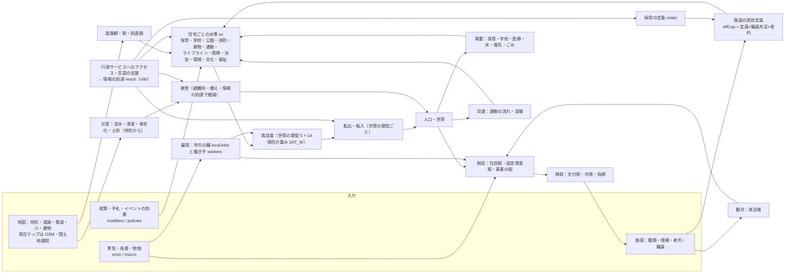

# 計算の依存関係（v90）

スムシティの毎月の計算（`src/sim/step.ts` の `stepMonth` → `src/sim/core.ts` の `recompute`）で、主な指標が何から決まり、何に効くかをまとめます。数値はすべてゲーム上の仮定です（実在マップでも、地形・道路・鉄道・川・建物の位置だけが実データで、世帯・人口・資産・施設の能力・財政は推計）。

## 全体の図

## 指標の表

| 指標 | 単位 | 対象 | 期間 | 粒度 | 主な入力 | 主な効き先 | 初期値の推計 |
|---|---|---|---|---|---|---|---|
| 世帯（hh） | 世帯 | 住宅の建物ごと、類型 5（単身・夫婦のみ・子育て未就学・子育て就学・高齢） | 月 | 住宅 1 棟 | 転入・転出・類型の遷移 | 需要・税・満足 | 架空：シナリオの固定値／実在：建物の床面積と用途から推計（`REAL.lots`） |
| 人口 pop | 人 | 市全体 | 月 | 市 | 世帯 × 類型の人数 `P.persons` | 交付税・行政費・需要 | 世帯から |
| 保育 care | 0〜1（定員 ÷ 需要） | 未就学児のいる世帯 | 月 | 住宅（到達圏の施設） | 保育所の実効定員、保育士の採用 | 満足（子育て）、待機児童 | 需要＝子育て世帯×率 |
| 学校 school | 0〜1 | 就学児のいる世帯 | 月 | 通学区（最寄り校） | 小 6・中 4 の定員比、図書館 | 満足（子育て就学） | 同上 |
| 通勤 commute | 0〜1 | 全世帯 | 月 | 住宅 | 道路・鉄道の所要時間と混雑比 | 満足、転出 | 経路探索から |
| 治安 crime / safetyLv | 0〜1 | 全世帯 | 月 | 市（crime）・住宅（safetyLv） | 空き家率・商店・夜の街・遊技場・警察・政策・脅威 | 満足（治安） | 計算値。**v90 から外国人住民の数・割合は入れない** |
| 行政サービスへのアクセス access | 0〜1 | 住民全体 | 月 | 市 | 多文化共生センター・相談窓口の政策・行政 DX・スマートシティ | reach・孤立・採用の定着 | 0.3 |
| 言語の支援 lang（1−lang＝言語の壁） | 0〜1 | 日本語に不慣れな住民とその子ども | 月 | 市 | 日本語教室・多文化共生センター・外国人学校 | reach・採用の定着 | 0.15 |
| 情報の到達 reach | 0〜1 | 情報が届きにくい住民（高齢者の一部・障害のある人・転入直後・日本語に不慣れな人。割合 hard） | 月 | 市 | access・lang・高齢化率・外国人住民の割合（重みだけ） | 福祉の満足・転出・災害の被害 | 計算値（約 0.55〜0.6） |
| 採用 hire | 人/月 | 市の施設の職種 | 月 | 職種 | 定員・政策 `hire:職種`・retain | 実効定員 | 定義 `hire` |
| 税収 | 万円/月 | 市 | 月 | 建物 | 世帯×所得×税率×景気、戸数×固定資産税、事業の売上・`bizTax` | 財政 | `P` の係数 |
| 来訪者 visitors | 人/月 | 市 | 月 | 市 | 観光施設・知名度・到達 | 事業の税・宿泊税 | 施設から |
| 浸水 floodHH | 世帯 | 浸水のおそれのある区画 | 月（被害はイベント時） | 区画 | 地形（川・水面からの距離と高さ）・調整池・ダム・堤防 | 満足・災害の被害 | 地形から |
| 満足 sat | 0〜1 | 世帯 | 月 | 住宅×類型 | 14 項目 × `SAT_W` ＋ satAdd | 転出・支持率 | 計算値 |

## 単なる加算ボーナスに近い項目

需要や供給（定員・到達・人手・費用）を介さず、満足（`sat:*`）や税・転入に直接足している項目です。

| 箇所 | 施設・政策 | 効果 | 評価 |
|---|---|---|---|
| core.ts satAdd | スマートシティ管制センター（cityOS） | 全類型 +0.01 | 候補：行政 DX として access へ（v90 で access にも +0.05。sat の直接加算は残す） |
| core.ts satAdd | 自動運転バスの車庫・自動運転タクシー | 高齢 +0.01/+0.015 | 候補：通勤・移動の水準（commute / 買物の到達）へ |
| core.ts satAdd | 結婚式場・ゲームセンター・人型ロボットの開発拠点・クラブチーム | 類型別 +0.004〜0.008 | 候補：文化・スポーツの水準（culture）へ |
| core.ts satAdd | カジノ・米軍基地・歓楽街 | −0.008〜−0.012 | 候補：騒音・治安（env / safety）へ |
| config.ts 政策 | 給食費の無償化・子どもの医療費・児童手当の上乗せ | sat:2/3 +0.015〜0.025 | 家計の負担軽減として妥当。候補：住宅負担（可処分所得）項目へ |
| config.ts 政策 | 水道の基本料金の減免・見守りネットワーク・消費生活センター | sat:4 +0.004〜0.006 | 候補：福祉（welfare）・bukkaRelief へ一本化 |
| config.ts 政策 | 自転車道とシェアサイクル | sat:0 +0.006 | 候補：通勤（commute）へ |
| config.ts 政策 | 子ども食堂・いじめ対策 | sat:2/3 +0.006〜0.012 | 候補：福祉・学校の水準へ |
| actions.ts 手札 | IT 企業とスマートシティ提携 | sat:all +0.005・econ・転入（ずっと） | 候補：access と通信の水準へ |
| actions.ts 手札 | 市民まつり・市民マラソン | sat:all・支持率（期間つき） | 行事の一時的な効果として妥当 |
| config.ts 政策（v89 まで） | 外国人住民の支援窓口（tabunka） | 単身・夫婦の転入 ×1.1/×1.05、保育士の採用 ×1.1 | **v90 で直した**：access +0.2・lang +0.08 に置き換え、reach を介して効く |
| config.ts 政策（v89 まで） | 日本語教室と生活相談 | support（治安の減点を和らげる） | **v90 で直した**：言語の支援として reach・retain に効く |
| core.ts（v89 まで） | 外国人住民の割合と不法滞在の推計 | crime に直接加点 | **v90 で廃止** |
| actions.ts（v89 まで） | 隣町との合併 | 交付金 ×1.08（10 年）・建設補助・転入 | **v90 で直した**：広域連合（共同処理の能力・負担金・維持費の分担） |

## 今後直す候補

- satAdd の個別の施設（上表）を、該当する水準（culture / commute / env / safety）を介した効果に置き換える。
- 子育ての給付系の政策は、住宅負担の項目（所得に対する負担）を介す形に。
- 外国人住民の子どもの就学（不就学の把握）を、学校の水準と lang で表す（v90 は表示の説明だけ）。
- 補助・広域共同事業の費用負担の割合を、種別ごとの係数として buildCost に入れる（v90 は表示だけで、建設費の欄の意味を説明）。
